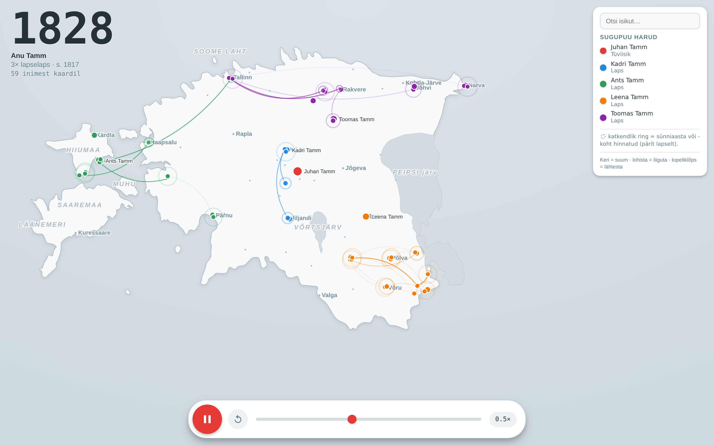

# sugupuu-kaardil

**Vaata oma Geni.com sugupuud animeeritud Eesti kaardil.**
Mõeldud kasutamiseks [Claude](https://claude.ai) Projectis. Programmeerimist ei ole vaja.



---

## 1. Mida see teeb?

Sa annad Geni.com sugupuu-ekspordi. Claude teeb sellest ühe **.html faili**:

- Iga isik on kaardil täpp oma sünnikohas.
- Aeg liigub esivanematest tänase päevani. Täpid ilmuvad sünniaasta järgi.
- Klõps isikul avab tema **Geni.com profiili**.
- **Katkendlik ring** = sünnikoht või -aasta on hinnatud.
  Nii näed kiiresti, millised andmed vajavad Genis täpsustamist.
- Otsing, suum ja lohistamine aitavad leida üksikisiku tihedast klastrist.

Toetatud on kaks puu tüüpi:

| Tüüp | Algus | Suund |
|------|-------|-------|
| Esivanemad (*Ancestor report*) | sina | sinust esivanemateni |
| Järeltulijad (*Descendant report*) | üks esivanem | esivanemast tänase päevani |

---

## 2. Kasutamine

### Samm 1 — Ekspordi andmed Geni.com-ist

**Esivanemad:**
1. Ava Genis oma profiil.
2. Vajuta üleval **Actions → Ancestor report**.
3. Vali **kõik põlvkonnad**.
4. Märgi kogu aruanne hiirega ja kopeeri.

**Järeltulijad:**
1. Ava Genis esivanema profiil.
2. Vajuta üleval **Actions → Descendant report**.
3. Vali **kõik põlvkonnad**.
4. Märgi kogu aruanne hiirega ja kopeeri.

### Samm 2 — Salvesta .md failina

1. Kleebi tekst **Google Docs** dokumenti.
2. Vali **Fail → Laadi alla → Markdown (.md)**.

> Word ei salvesta otse .md faili. Kasuta Google Docsi.

### Samm 3 — Loo Claude Project

1. Ava [claude.ai](https://claude.ai) → **Projects → Create project**.
2. Lae Projecti failidesse:
   - `build_map.py`
   - `parse.py`
   - `build_html.py`
   - `map.json`
   - `SPEC_family_migration_map.md`
   - `demo_synthetic.md` | Väljamõeldud näidispuu (112 isikut), millest tehti ekraanipilt |
3. Kopeeri allolev tekst Projecti **Instructions** välja:

```text
Kui lisan .md sugupuu-ekspordi:
1. Kopeeri /mnt/project/ pipeline-skriptid (build_map.py, parse.py, build_html.py)
   ja map.json töökausta.
2. Jooksuta parse.py (uue .md peal), siis build_html.py.
   Kasuta olemasolevat map.json — ära lae kaarti uuesti, kui pole vaja.
3. Vaikimisi: nimedega, edasisuunaline (esivanematest tänase päeva järglaseni),
   0.5x, suum nupuga (kasutaja ise kasutab vajadusel).
   Küsi ainult siis, kui variant on ebaselge (tagurpidi / anon / inglise).
4. Anna tulemus alati .html failina.
Reeglid: koordinaadid ligikaudsed juhul kui on vaid talunimi teada;
puuduvad kohad pärida lapselt; puuduvad aastad hinnata ~30 a/põlvkond;
piiriülesed sünnid jäta piiri taha.
```

### Samm 4 — Käivita

Kirjuta Projecti vestlusesse:

```text
Visualiseeri!
```

Ava saadud .html fail brauseris.

---

## 3. Variandid

Lisa soov käsule, näiteks `Visualiseeri! Anonüümne, inglise keeles.`

| Soov | Tulemus |
|------|---------|
| *tagurpidi* | aeg liigub tänasest minevikku |
| *anonüümne* | nimed ja Geni lingid eemaldatud (v.a. lähteisik) |
| *inglise keeles* | kasutajaliides inglise keeles |

---

## 4. Privaatsus

- Aruanne võib sisaldada **elavaid inimesi**.
- Enne avalikku jagamist kasuta **anonüümset** varianti.
- Ära lisa oma .md faili avalikku GitHubi repo'sse.

---

## 5. Piirangud

- Kohad leitakse **käsitsi koostatud sõnastikust** (`PLACES` failis `parse.py`).
  See katab kõik Eesti maakonnad ja osa külasid. Tundmatu küla → maakonna keskpunkt või lapse sünnikoht.
- Koordinaadid on **ligikaudsed** (kihelkond / küla), mitte talu täpsusega.
- Hinnatud sünniaastad (~30 a/põlvkond) on jämedad.
- Kaart on **ainult Eesti**. Piiriülesed sünnid (nt Petseri) jäävad piiri taha.
- Sama isik mitmes harus (*pedigree collapse*) on kaardil mitu korda.

Puuduva küla lisamiseks: `parse.py` trükib sobitamata kohanimed välja. Lisa need `PLACES` sõnastikku.

Täpne tehniline kirjeldus: [`SPEC_family_migration_map.md`](SPEC_family_migration_map.md)

---

## 6. Failid

| Fail | Roll |
|------|------|
| `parse.py` | Loeb .md, leiab kohad, hindab puuduvad andmed → `nodes.json` |
| `build_html.py` | Teeb lõpliku .html faili |
| `build_map.py` | Eesti kontuuri genereerimine (vaja ainult uue riigi puhul) |
| `map.json` | Valmis Eesti kaart (saared + järved) |
| `sample_descendants.md` | Väike näidispuu testimiseks |
| `SPEC_family_migration_map.md` | Tehniline spetsifikatsioon |

---

## 7. Litsents ja allikad

- Kaardiandmed: [Natural Earth](https://www.naturalearthdata.com) (avalik omand).
- Litsents: Vabavara
- Autor: Hannes Seeberg
